# MLSYS Phase 3 项目报告：自动化 LLM 推理 Runtime 生成 Agent

## 摘要

前三章介绍 Phase 3 项目：自动生成 LLM 推理 Runtime 的 Agent 设计、总体架构和核心模块实现。第四章介绍整个 MLSYS PJ 从 Phase 1 到 Phase 3 的演进过程，对比三期需求变化、架构变化和模块增删原因。

## 目录

- [1. 项目目标](#1-项目目标)
- [2. 架构设计](#2-架构设计)
  - [2.1 总体架构](#21-总体架构)
  - [2.2 Agent 流程图](#22-agent-流程图)
- [3. 模块设计](#3-模块设计)
  - [3.1 启动与日志模块](#31-启动与日志模块)
  - [3.2 Agent 编排模块](#32-agent-编排模块)
  - [3.3 Engine 文件管理模块](#33-engine-文件管理模块)
  - [3.4 评测工具模块](#34-评测工具模块)
  - [3.5 Benchmark 分析模块](#35-benchmark-分析模块)
  - [3.6 运行状态与提交门禁模块](#36-运行状态与提交门禁模块)
- [4. Phase 1/2/3 Agent 架构演进](#4-phase-123-agent-架构演进)

## 1. 项目目标

本项目要实现一个可以自动生成 LLM 推理 Runtime 的 Agent，而不是直接提交静态 `engine.py`。评测系统执行 `run.sh` 后，Agent 需要在 `workspace/engine.py` 中生成满足接口要求的 Runtime。生成的 Runtime 需要支持 `create_engine(...)`、`prefill(...)`、`decode(...)` 和 `remove(...)`，并能根据传入的 `model_config` 与权重目录完成 LLaMA-like decoder-only 模型推理。正确性由 reference model 对比 logits 判断，吞吐由 prefill、decode 和 mixed 请求 trace 测量。项目的工程重点是让 Agent 形成“生成代码、测试正确性、跑 benchmark、分析瓶颈、提交更优版本”的闭环。

## 2. 架构设计

### 2.1 总体架构

总体设计围绕一个闭环：入口程序启动 Agent，Agent 调用工具生成和修改候选 Runtime，评测模块提供正确性与性能反馈，验证通过后产出稳定 `workspace/engine.py`。架构图只保留主链路和关键边界，细节放到模块设计中展开。

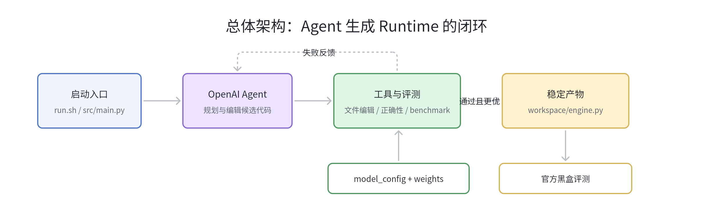

### 2.2 Agent 流程图

Agent 的核心不是一次性生成代码，而是“编辑、测试、基准、分析、门禁”的循环。

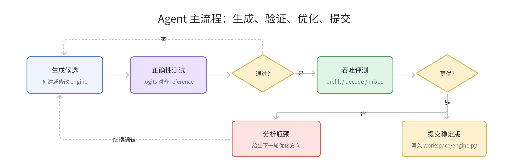

流程里的关键门禁有两个：

- Agent 工具 `can_agent_exit` 只根据运行时间或检查次数判断是否允许结束。
- Runner 外层 `_exit_gate_failures()` 会额外检查最新 candidate 是否通过 correctness、是否 benchmark、是否有稳定 baseline。只要其中任一不满足，最终输出会被拒绝并转化为下一轮用户反馈。

## 3. 模块设计

### 3.1 启动与日志模块

对应文件：

- `src/main.py`
- `README.md`

#### 模块架构图

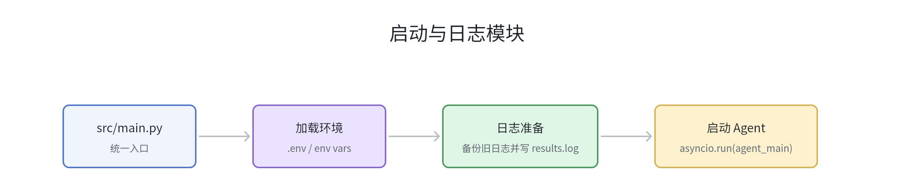

#### 实现细节

`src/main.py` 负责把运行环境准备好，再把控制权交给 Agent：

- 使用 `load_dotenv(override=True)` 加载 `.env`，让本地开发和提交环境都可以通过环境变量统一配置。
- 通过 `LOG_FILEPATH` 控制日志位置，未设置时使用 `logs/app.log`。
- 如果日志文件已存在且非空，先按 `YYYYMMDD_HHMMSS` 时间戳重命名备份，避免覆盖上一轮运行证据。
- 用 `loguru` 配置日志轮转和保留策略，`rotation="10 MB"`，`retention="7 days"`。
- 使用 `asyncio.run(agent_main.main())` 启动异步 Agent 主流程。

#### 设计考虑

该模块尽量保持薄入口，只做环境、日志和异步启动三件事。这样可以保证评测脚本、开发命令和提交命令都复用同一套 Agent 主逻辑，也方便用 `LOG_FILEPATH=/workspace/results.log` 把日志写到评测要求的产物路径。

### 3.2 Agent 编排模块

对应文件：

- `src/agent/main.py`
- `prompts/instructions.md`
- `prompts/input.md`
- `src/agent/hooks/tool_call_logger.py`

#### 模块架构图

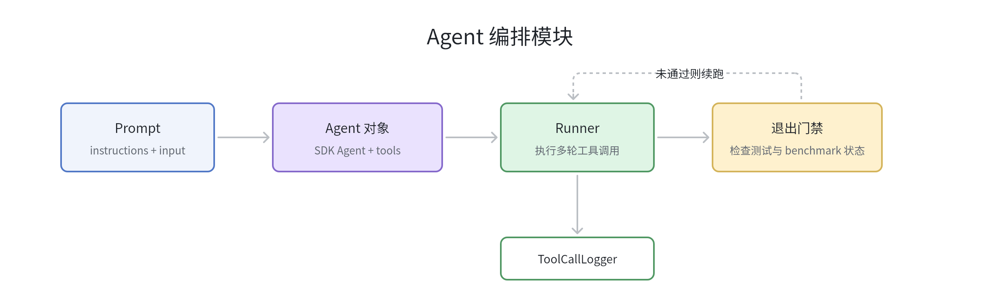

#### 实现细节

`src/agent/main.py` 使用 OpenAI Agents Python SDK 构造 Agent：

```python
agent = Agent(
    name="Agent",
    instructions=read_file("prompts/instructions.md"),
    tools=[
        engine_file.view_engine_file,
        engine_file.delete_old_and_create_engine_file_from_template,
        engine_file.replace_in_engine_file,
        engine_file.append_to_engine_file,
        evaluation.test_correctness,
        evaluation.benchmark_throughput,
        benchmark_analysis.analyze_benchmark_result,
        exit_judge.can_agent_exit,
    ],
)
```

主循环做了三层控制：

1. 每轮调用 `Runner.run(...)`，允许 Agent 在 `AGENT_MAX_TURNS` 限制内自主使用工具。
2. Agent 返回 final output 后，外层调用 `_exit_gate_failures()` 做强制门禁。
3. 如果门禁失败，把失败原因变成新的 user input，要求 Agent 继续改进。

#### 设计考虑

Agent 的最终回答不直接可信，必须由外层 runner gate 校验。这样可以避免模型在未测试、未 benchmark 或没有稳定版本的情况下提前结束。该设计把“自我声明完成”改成了“状态机证明完成”。

`ToolCallLogger` 继承 `RunHooks`，在工具开始和结束时记录工具名、输入和输出。它会尝试把 JSON 字符串格式化，保留可审计的工具调用轨迹，便于赛后定位 Agent 为什么做出某个编辑或提交决定。

### 3.3 Engine 文件管理模块

对应文件：

- `src/agent/tools/engine_file.py`
- `prompts/engine_template.py`
- `prompts/engine_baseline.py`

#### 模块架构图

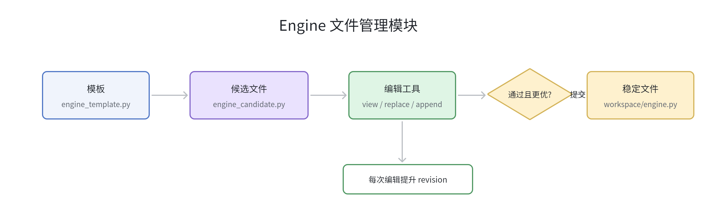

#### 实现细节

文件管理模块将“候选版本”和“稳定版本”分离：

- 稳定版本：`ENGINE_FILEPATH`，默认 `/workspace/engine.py`。
- 候选版本：默认在同目录生成 `engine_candidate.py`。

Agent 编辑的永远是候选版本。`benchmark_throughput` 工具在候选通过正确性并优于 baseline 后，才调用 `commit_candidate_engine_file()` 提交为稳定版本。

关键函数：

- `get_committed_engine_filepath()`：解析稳定产物路径。
- `get_candidate_engine_filepath()`：解析候选产物路径，避免候选路径和稳定路径相同。
- `ensure_candidate_engine_file()`：候选不存在时，优先从稳定版本复制；稳定版本不存在时，从模板创建。
- `replace_in_engine_file(old, new)`：只替换第一个匹配片段，适合 Agent 做局部修补。
- `append_to_engine_file(content)`：追加内容，适合补充 helper 或新类。
- `commit_candidate_engine_file()`：先写同目录临时文件，`fsync` 后 `os.replace` 原子替换稳定 engine。

#### 设计考虑

候选/稳定双文件策略是性能回归控制的基础。Agent 可以大胆探索候选文件，但稳定 `engine.py` 只接收“正确性通过且 benchmark 分数更好”的版本。原子替换可以防止写入过程中断导致稳定文件损坏。

`engine_template.py` 只有接口骨架，强制 Agent 从明确 API 开始；`engine_baseline.py` 提供一个完整参考方向：它能加载权重、实现 RMSNorm、RoPE、attention、MLP 和请求状态，但 decode 采用全序列重算，性能不是最终目标。

### 3.4 评测工具模块

对应文件：

- `src/agent/tools/evaluation.py`
- `src/util/module_runner.py`

#### 模块架构图

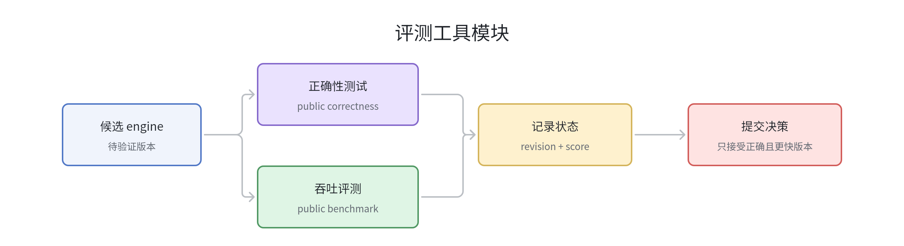

#### 实现细节

`evaluation.py` 把 public evaluator 包装成 Agent 工具。它不启动子进程，而是通过 `run_module_main(...)` 在当前 Python 进程里临时调整 `sys.argv` 和 `sys.path`，然后捕获 stdout/stderr。

正确性和吞吐评测直接使用课程提供的官方评测框架，本项目只负责把它们封装为 Agent 可调用工具，并把返回结果写入运行状态。

正确性工具参数由环境变量控制：

- `MODEL_CONFIG_FILEPATH`
- `WEIGHT_DIR`
- `EVALUATION_DEVICE`
- `EVALUATION_ATOL`
- `EVALUATION_RTOL`

基准工具参数由环境变量控制：

- `MODEL_CONFIG_FILEPATH`
- `WEIGHT_DIR`
- `EVALUATION_DEVICE`
- `EVALUATION_WARMUP`
- `EVALUATION_REPEAT`

`benchmark_throughput()` 的特殊逻辑：

1. 先 benchmark candidate。
2. 从输出 JSON 计算候选综合分数。
3. 如果当前没有 baseline 且稳定 engine 已存在，则 benchmark 稳定版本作为 baseline。
4. 调用 `should_commit_candidate(candidate_score)` 判断是否提交。
5. 如果提交，则把 candidate 原子替换为 stable，并记录提交状态。

#### 设计考虑

把 evaluator 包装成工具后，Agent 可以像调用普通函数一样获得结构化 JSON 反馈。正确性和 benchmark 同时更新 `run_state`，使“测试结果”和“文件 revision”绑定，避免旧测试结果被误用于新代码。

### 3.5 Benchmark 分析模块

对应文件：

- `src/agent/tools/benchmark_analysis.py`

#### 模块架构图

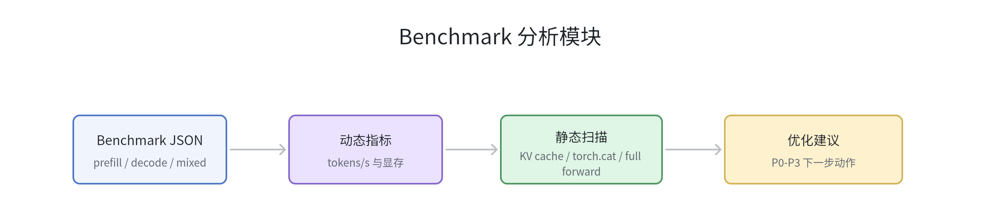

#### 实现细节

该模块同时使用动态指标和静态源码信号。

动态指标包括：

- `prefill_tokens_per_second`
- `decode_tokens_per_second`
- `mixed_decode_tokens_per_second`
- `prefill_to_decode_tps_ratio`
- `mixed_to_decode_tps_ratio`
- `approx_decode_case_ms_per_decode_token`
- 各 case 的 `peak_memory_mb`

静态扫描会读取当前候选 engine，并检查常见低效模式：

| 信号 | 严重度 | 含义 |
| --- | --- | --- |
| `decode_calls_full_forward` | high | decode 调用全序列 forward，通常每步重算 |
| `decode_uses_torch_cat` | medium | decode 直接拼 token，可能反复分配 |
| `decode_hot_path_uses_torch_cat` | high | helper 中拼 KV 或 token history |
| `decode_rebuilds_padded_kv_batch` | high | 每步重建 padding 后的 batched KV |
| `request_state_on_cpu` | medium | 热状态在 CPU，会引入 host/device 拷贝 |
| `no_obvious_kv_cache` | high | 没有明显 KV cache |
| `kv_cache_may_not_be_per_layer` | high | cache 不明确按 layer 更新 |
| `manual_attention_softmax` | medium | 使用显式 matmul + softmax，未使用 fused attention |
| `uses_pytorch_sdpa` | info | 使用 PyTorch SDPA |
| `no_triton_kernels` | info | 暂无 Triton kernel |
| `no_cpp_cuda_extensions` | info | 暂无 C++/CUDA 扩展 |

根据这些信号，模块输出 P0 到 P3 的优化建议：

- P0：真实逐层 KV cache、避免 full-sequence recompute、避免 decode 热路径 `torch.cat`。
- P1：改善 batch 请求状态布局、减少 padding 和调度开销。
- P2：使用 PyTorch fused primitive，降低 attention 和临时 tensor 成本。
- P3：基于 profiler 再考虑 Triton 或 C++/CUDA。

#### 设计考虑

模型生成代码时容易做“看起来快但语义错误”的优化，例如用 token history 全量重算替代 KV cache。该分析模块显式扫描这类结构性问题，让 Agent 的优化方向优先对齐课程要求，而不是只追求局部 benchmark 偶然变快。

### 3.6 运行状态与提交门禁模块

对应文件：

- `src/agent/run_state.py`
- `src/agent/tools/exit_judge.py`
- `src/agent/main.py`

#### 模块架构图

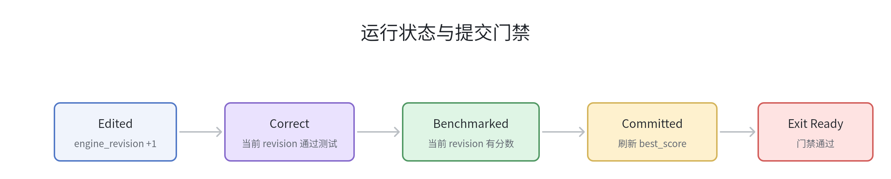

#### 实现细节

`EngineValidationState` 记录：

```python
@dataclass
class EngineValidationState:
    engine_revision: int = 0
    correctness_revision: int = -1
    benchmark_revision: int = -1
    committed_revision: int = -1
    best_score: float | None = None
    last_benchmark_score: float | None = None
    last_commit_message: str = "no candidate has been committed in this run"
```

状态推进规则：

- 只要 Agent 编辑 engine，`engine_revision += 1`。
- 正确性测试输出 JSON 且 `status == "passed"` 时，`correctness_revision = engine_revision`。
- benchmark 输出可解析并可计算 score 时，`benchmark_revision = engine_revision`。
- 只有 `correctness_revision == engine_revision` 且 `benchmark_revision == engine_revision`，候选才有资格提交。
- `best_score` 为空时，首次有效候选可以提交；否则必须超过 baseline。
- `ENGINE_MIN_IMPROVEMENT_RATIO` 可设置最小提升比例，默认 0。

Benchmark 综合分数计算方式：

```text
score = sum(total_tokens) / sum(elapsed_seconds)
```

`engine_best.json` 持久化最佳分数、稳定 engine 的 sha256、revision、benchmark 输出和更新时间。加载时会校验稳定 engine hash，防止旧 metadata 错配到新文件。

`exit_judge.py` 本身只按两类条件判断是否“允许尝试退出”：

- 运行时间超过 `AGENT_EXIT_MAX_RUNTIME_SECONDS`。
- 调用检查次数超过 `AGENT_EXIT_MAX_CHECKS`。

真正的退出还必须经过 `agent/main.py` 的 `_exit_gate_failures()`，包括：

- 最新候选 engine edit 已通过 `test_correctness`。
- 最新候选 engine edit 已运行 `benchmark_throughput`。
- 已存在稳定 benchmark baseline。

#### 设计考虑

这个模块的核心是把“文件内容版本”和“测试结果版本”绑定。没有 revision 机制时，Agent 可能在一次通过测试后继续编辑代码，然后沿用旧测试结果退出。当前实现避免了这个问题。

## 4. Phase 1/2/3 Agent 架构演进

三期项目的共同主线是“让 Agent 接管系统工程中的专家工作”。变化点不在于是否调用 LLM，而在于 Agent 面对的对象越来越大：Phase 1 面向硬件指标，Phase 2 面向单个 CUDA 算子，Phase 3 面向完整 LLM 推理 Runtime。

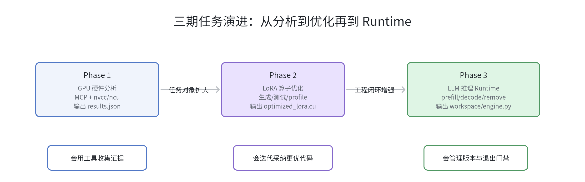

### 4.1 需求如何变化

| 阶段 | 目标产物 | 核心任务 | 正确性/评价方式 |
| --- | --- | --- | --- |
| Phase 1 | `results.json` | 生成 micro-benchmark，分析 `ncu` 指标，推断 GPU 硬件参数 | 与真实硬件参数对齐，并由 LLM-as-a-Judge 评价推理方法 |
| Phase 2 | `optimized_lora.cu` | 生成 LoRA 算子的 CUDA 实现，并迭代优化平均 speedup | `torch.allclose` 保证正确性，官方 harness 计算 speedup |
| Phase 3 | `workspace/engine.py` | 生成 decoder-only LLM 推理 Runtime，支持 prefill/decode/remove | logits 对齐 reference model，官方 serving trace 测吞吐 |

需求演进可以概括为三点：

- **对象扩大**：硬件参数 → 单算子 CUDA → 多请求 Runtime。
- **状态变复杂**：Phase 1 基本无长期代码状态；Phase 2 维护当前最优 `.cu`；Phase 3 维护候选/稳定 engine、请求状态和验证 revision。
- **反馈更严格**：Phase 1 重证据和推理；Phase 2 加入 correctness + speedup；Phase 3 增加黑盒 Runtime API、服务式 trace 和退出门禁。

### 4.2 架构如何演进

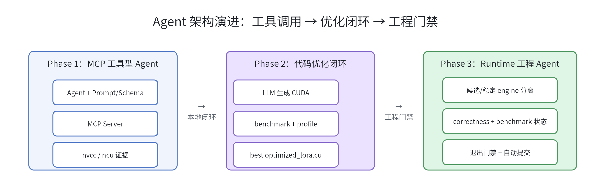

Phase 1 的架构重点是“工具外置”：Agent 通过 MCP 服务调用 `nvcc` 和 `ncu`，再把结果按 JSON Schema 输出。它解决的是 Agent 如何可靠使用外部 GPU 分析工具。

Phase 2 删除了 MCP 服务层，改为项目内部直接封装 benchmark 和 profile 函数。这样做的原因是任务从“分析报告”变成“反复生成和采纳代码”，闭环的关键变成 best-code 管理、编译失败修复和 speedup 比较。

Phase 3 在 Phase 2 的闭环基础上继续工程化：引入候选/稳定文件隔离、revision 级验证状态、benchmark 后自动提交、退出门禁和静态瓶颈分析。这样做是因为 Runtime 产物更复杂，一次错误编辑可能破坏最终 `engine.py`，因此必须用状态机约束“什么时候能提交”和“什么时候能退出”。

### 4.3 模块增删关系

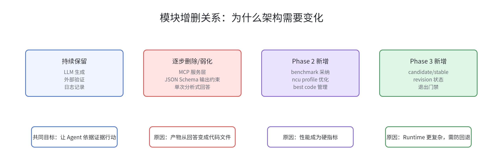

| 模块/机制 | Phase 1 | Phase 2 | Phase 3 | 变化原因 |
| --- | --- | --- | --- | --- |
| MCP 服务 | 保留，用于暴露 `nvcc`/`ncu` 工具 | 删除 | 删除 | 后两期工具调用更贴近本地工程闭环，直接函数封装更轻 |
| Prompt + Schema | 保留，约束硬件分析输出 | 弱化为代码生成 prompt | 弱化为 Agent instruction + workflow prompt | 产物从结构化回答转为代码文件，Schema 不再是主约束 |
| Benchmark 工具 | 无独立采纳逻辑 | 新增，决定 `.cu` 是否可采纳 | 保留并升级，决定 candidate 是否提交 | 性能成为硬指标，需要可重复测量 |
| Profile/分析工具 | `ncu` 指标用于硬件推断 | `ncu` profile 指导 CUDA 优化 | 静态源码信号 + benchmark 指标指导 Runtime 优化 | 分析对象从硬件/算子转为 Runtime 结构瓶颈 |
| 最优产物管理 | 无 | 新增 `optimized_lora.cu` 最优版本 | 升级为 candidate/stable 双文件 | Phase 3 产物更大，必须避免坏版本覆盖稳定版本 |
| 退出门禁 | 无 | 主要依赖时间和迭代次数 | 新增 correctness、benchmark、baseline 三重门禁 | 防止未测版本或无稳定版本提前退出 |

### 4.4 总结

从 Phase 1 到 Phase 3，Agent 架构的重心逐步从“会使用工具”转向“能管理工程闭环”。Phase 1 证明 Agent 可以通过 MCP 获取硬件证据；Phase 2 把证据接入代码生成和性能采纳；Phase 3 则把这个闭环扩展成带版本隔离、验证状态和退出门禁的 Runtime 生成系统。
